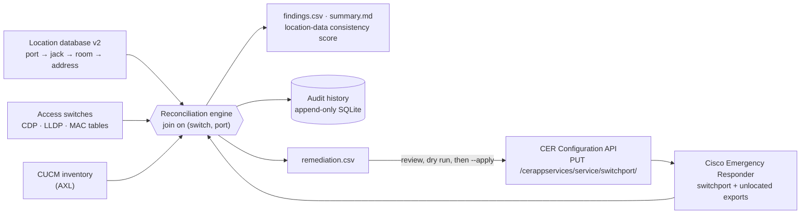

# E911 Reconciliation Engine

*Introduced in v0.2.0 · code: [`python/e911/`](../../python/e911) · playbooks:
[`e911-reconcile.yml`](../../ansible/playbooks/e911-reconcile.yml),
[`e911-location-update.yml`](../../ansible/playbooks/e911-location-update.yml)*

## Purpose

FCC rules implementing RAY BAUM's Act require dispatchable location for applicable
MLTS 911 calls, including a validated street address and additional location
information, such as building, floor or room, as necessary to identify the caller's
location. Cisco Emergency Responder (CER) tracks which switch port a phone is on and
uses the Emergency Response Location (ERL) assigned to that port. Whether that ERL
corresponds to the correct room depends on accurate facility-maintained records of
which jack each port is patched to and which room each jack is in.

The reconciliation engine compares four data sources, identifies discrepancies,
calculates a location-data consistency score, and generates proposed CER
configuration changes for review and controlled remediation. The engine evaluates
agreement between available records and observed network attachment data rather
than independently verifying physical room-location accuracy or actual 911 call
delivery.

## How it complements CER

| Capability | CER | Reconciliation engine |
| --- | --- | --- |
| Track which switch port a phone is on | Yes (SNMP/CDP, CAM tables) | Uses CER's result and cross-checks it against available CDP, LLDP and MAC tables |
| Assign ERLs to ports | Yes (admin UI, Configuration API) | Generates proposed assignments from the location database and supports controlled updates through CER's API |
| Know which jack and room a port reaches | Depends on maintained location configuration | Location database v2: port → patch panel → jack → room → civic address, based on facility-maintained records |
| Detect that CER's ERL disagrees with the hospital's records | Not an independent facility-record comparison | `PORT_ERL_MISMATCH`, `PORT_NOT_IN_CER` |
| Detect switches and ports CER is not tracking | Partly (unlocated phones) | `SWITCH_NOT_IN_CER`, `UNMAPPED_PORT`, `CER_UNLOCATED` with observed port information where available |
| Detect CER tracking that has gone stale | Native tracking and status functions exist | `CER_TRACKING_STALE` through cross-source comparison |
| Account for analog stations | Manual entries only | `ANALOG_UNMAPPED` against CUCM inventory |
| Require a complete location record before a change | Platform validations vary by resource and version | Proposed location updates require building, floor and room |
| Measure location-data consistency over time | Native reports exist, but not the same cross-source agreement metric | Location-data consistency score per run, append-only audit history, new/resolved findings |
| Vendor-neutral | Platform-specific configuration | Vendor-neutral location database and findings; CER adapter implemented to date |

## Data flow



Port-based records are joined on a normalized `(switch, port)` key to reduce false
drift caused by differences such as `GigabitEthernet1/0/12` versus `Gi1/0/12` or
hostname versus IP address where switch identity can be resolved.

## Finding catalog

| Code | Severity | Meaning | Typical fix |
| --- | --- | --- | --- |
| `UNMAPPED_PORT` | critical | A phone is on a port with no jack/room record | Trace and survey the jack; add a record |
| `PORT_ERL_MISMATCH` | critical (phone present) / high | CER's configured ERL differs from the facility-maintained location record | Review and validate proposed changes before applying `remediation.csv` |
| `PORT_NOT_IN_CER` | high | Recorded port has no ERL in CER | Review and validate proposed changes before applying `remediation.csv` |
| `SWITCH_NOT_IN_CER` | high | CER is not tracking a switch in the location database | Add the switch to CER and run discovery |
| `DEVICE_MOVED` | high | A phone recorded at one jack is on another port | Confirm the move; update `device_name` and use the verified location record for the new port |
| `CER_UNLOCATED` | high | CER cannot place the phone | Add the switch to CER or assign a manual ERL |
| `ANALOG_UNMAPPED` | high | Analog station with no complete location record | Record its room and jack |
| `INCOMPLETE_LOCATION` | high | Record missing building, floor or room | Survey and complete the record |
| `DUPLICATE_PORT_MAPPING` | high | One port mapped to several rooms | Trace the port; keep one record |
| `CER_TRACKING_STALE` | medium | CER tracking data disagrees with observed switch attachment data | Check CER's discovery schedule |
| `DEVICE_NOT_OBSERVED` | medium | Wired phone in CUCM not seen on any surveyed switch | Extend the survey or retire the device |
| `MISSING_CIVIC_ADDRESS` | medium | Street, city, state or ZIP missing | Complete the address |
| `MISSING_SWITCH_PORT` | medium | Record not tied to a switch port | Trace the jack to its port |
| `DUPLICATE_JACK` | medium | One jack recorded on several ports | Confirm the patch |
| `STALE_VERIFICATION` | low | Jack not verified within the policy window (default 365 days) | Re-verify on site |

## Location-data consistency score

```
consistency = observed wired phones whose current port resolves
              to a complete location record
              (and, when CER data is supplied, to the same ERL in CER)
              ÷ total wired phones observed on the network
```

The score measures the proportion of observed wired phones that satisfy the
configured location-data consistency criteria. When expressed as a percentage,
the proportion is multiplied by 100.

It measures agreement between available data sources, not independently verified
physical room-location accuracy or confirmed delivery of the correct location to
a Public Safety Answering Point (PSAP). Physical location verification and
authorized end-to-end emergency call testing remain necessary.

The existing software output field `accuracy_pct` is retained for backward
compatibility and represents this location-data consistency metric, not verified
dispatchable-location accuracy.

## Operating procedure

1. **Build the location database** from the cabling records and a site survey
   (`templates/e911-location-database-template.csv`), then run
   `e911 validate --locations data/locations.csv` until it is clean.
2. **Schedule `e911-reconcile.yml` nightly.** It collects switch tables with read-only
   `show` commands, reads CER exports, runs the engine and appends the run to the audit
   history. The job fails when drift reaches the chosen severity (`fail_on`, default
   `critical`).
3. **Review `reports/<run>/summary.md`.** Critical findings identify location-data
   discrepancies that could result in incorrect or incomplete location information
   during a 911 call and require prioritized investigation.
4. **Fix records first, then CER.** Correct the location database where the survey shows
   it is wrong; review and validate proposed changes in `remediation.csv` before
   applying them with `e911 push` or `e911-location-update.yml`. Both are dry runs
   until explicitly told to apply, and both refuse to write while CER discovery is
   running. Live CER writes remain to be validated before production use.
5. **Keep the history.** `e911 history --audit-db data/e911_audit.db` shows
   location-data consistency and open findings run by run; the database rejects
   edits and deletions through its application-level audit controls.

## Safety and privacy

- Switch collection sends only `show` commands.
- CER writes use the documented Configuration API, require `--apply` /
  `apply_changes=true`, are gated on CER discovery being complete and are logged.
- Credentials come from the environment or Ansible Vault, never from files in the repo.
- The intended inputs are network, telephony and facility data; no patient or
  clinical records are required.
- Sample data is synthetic: RFC 5737 documentation addresses and 555 numbers.

## Validation status

The engine is covered by an automated test suite (`tests/`) that runs through
GitHub Actions. Validation includes the synthetic sample hospital in
`samples/e911/` and unit tests covering the finding catalog.

CER interfaces are based on Cisco's published API documentation. API behavior
has been tested using simulated responses. Live CER write operations, physical
location accuracy and end-to-end PSAP delivery validation remain pending.

The current results demonstrate preliminary software functionality and
cross-source reconciliation, not production deployment or certified regulatory
compliance.

- [CER export API reference](https://developer.cisco.com/site/cer/documents/api-reference/)
- [CER Configuration API: ERL management](https://developer.cisco.com/docs/cer-config-api/latest/erl-management/)
