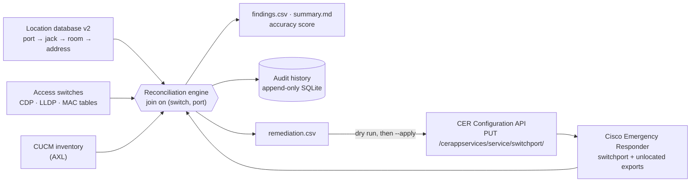

# E911 Reconciliation Engine

*Introduced in v0.2.0 · code: [`python/e911/`](../../python/e911) · playbooks:
[`e911-reconcile.yml`](../../ansible/playbooks/e911-reconcile.yml),
[`e911-location-update.yml`](../../ansible/playbooks/e911-location-update.yml)*

## Purpose

RAY BAUM's Act requires every 911 call from a multi-line telephone system to carry a
dispatchable location: the street address plus the building, floor and room the caller
is in. Cisco Emergency Responder (CER) tracks which switch port a phone is on and sends
the Emergency Response Location (ERL) assigned to that port. Whether that ERL is the
right room depends on data CER cannot see: which jack each port is patched to, and which
room each jack is in.

The reconciliation engine keeps that data honest. On every run it compares four
independent sources, reports every place they disagree, scores how many phones would
send a verified location right now, and produces the exact CER changes needed to fix
what it found.

## How it complements CER

| Capability | CER | Reconciliation engine |
| --- | --- | --- |
| Track which switch port a phone is on | Yes (SNMP/CDP, CAM tables) | Uses CER's result and checks it independently from CDP, LLDP and MAC tables |
| Assign ERLs to ports | Yes (admin UI, Configuration API) | Generates the assignments from the location database and applies them through CER's API |
| Know which jack and room a port reaches | No | Location database v2: port → patch panel → jack → room → civic address |
| Detect that CER's ERL disagrees with the hospital's records | No | `PORT_ERL_MISMATCH`, `PORT_NOT_IN_CER` |
| Detect switches and ports CER is not tracking | Partly (unlocated phones) | `SWITCH_NOT_IN_CER`, `UNMAPPED_PORT`, `CER_UNLOCATED` with the port where the phone actually is |
| Detect CER tracking that has gone stale | No | `CER_TRACKING_STALE` |
| Account for analog stations | Manual entries only | `ANALOG_UNMAPPED` against CUCM inventory |
| Require a complete dispatchable location before a change | No | Every write is validated for building, floor and room |
| Measure location accuracy over time | No | Accuracy score per run, append-only audit history, new/resolved findings |
| Vendor-neutral | No | The location database and findings do not depend on CER; the same data can feed another ERL platform |

## Data flow



Every source is joined on a normalized `(switch, port)` key, so `GigabitEthernet1/0/12`
on the switch, `Gi1/0/12` in CER and a hostname-vs-IP difference never show up as drift.

## Finding catalog

| Code | Severity | Meaning | Typical fix |
| --- | --- | --- | --- |
| `UNMAPPED_PORT` | critical | A phone is on a port with no jack/room record | Trace and survey the jack; add a record |
| `PORT_ERL_MISMATCH` | critical (phone present) / high | CER would send a different ERL than the record | Apply `remediation.csv` |
| `PORT_NOT_IN_CER` | high | Recorded port has no ERL in CER | Apply `remediation.csv` |
| `SWITCH_NOT_IN_CER` | high | CER is not tracking a switch in the location database | Add the switch to CER and run discovery |
| `DEVICE_MOVED` | high | A phone recorded at one jack is on another port | Update `device_name`; location follows the new port |
| `CER_UNLOCATED` | high | CER cannot place the phone | Add the switch to CER or assign a manual ERL |
| `ANALOG_UNMAPPED` | high | Analog station with no complete location record | Record its room and jack |
| `INCOMPLETE_LOCATION` | high | Record missing building, floor or room | Survey and complete the record |
| `DUPLICATE_PORT_MAPPING` | high | One port mapped to several rooms | Trace the port; keep one record |
| `CER_TRACKING_STALE` | medium | CER shows a different phone on the port than the switch | Check CER's discovery schedule |
| `DEVICE_NOT_OBSERVED` | medium | Wired phone in CUCM not seen on any surveyed switch | Extend the survey or retire the device |
| `MISSING_CIVIC_ADDRESS` | medium | Street, city, state or ZIP missing | Complete the address |
| `MISSING_SWITCH_PORT` | medium | Record not tied to a switch port | Trace the jack to its port |
| `DUPLICATE_JACK` | medium | One jack recorded on several ports | Confirm the patch |
| `STALE_VERIFICATION` | low | Jack not verified within the policy window (default 365 days) | Re-verify on site |

## Accuracy score

```
accuracy = phones whose current port resolves to a complete dispatchable location
           (and, when CER data is supplied, to the same ERL in CER)
           ÷ phones observed on the network
```

It answers one question for a compliance officer: if every phone on the network dialed
911 right now, what share would send the correct room?

## Operating procedure

1. **Build the location database** from the cabling records and a site survey
   (`templates/e911-location-database-template.csv`), then run
   `e911 validate --locations data/locations.csv` until it is clean.
2. **Schedule `e911-reconcile.yml` nightly.** It collects switch tables with read-only
   `show` commands, reads CER exports, runs the engine and appends the run to the audit
   history. The job fails when drift reaches the chosen severity (`fail_on`, default
   `critical`).
3. **Review `reports/<run>/summary.md`.** Critical findings are 911 calls that would
   carry the wrong location today.
4. **Fix records first, then CER.** Correct the location database where the survey shows
   it is wrong; apply `remediation.csv` with `e911 push` or `e911-location-update.yml`.
   Both are dry runs until explicitly told to apply, and both refuse to write while CER
   discovery is running.
5. **Keep the history.** `e911 history --audit-db data/e911_audit.db` shows accuracy and
   open findings run by run; the database rejects edits and deletions.

## Safety and privacy

- Switch collection sends only `show` commands.
- CER writes use the documented Configuration API, require `--apply` /
  `apply_changes=true`, are gated on CER discovery being complete and are logged.
- Credentials come from the environment or Ansible Vault, never from files in the repo.
- No PHI is read or stored: inputs are network, telephony and facility data.
- Sample data is synthetic: RFC 5737 documentation addresses and 555 numbers.

## Validation status

The engine is covered by an automated test suite (`tests/`) that runs on every push in
GitHub Actions against the synthetic sample hospital in `samples/e911/`, which exercises
every finding type. CER interfaces follow Cisco's published API documentation:

- [CER export API reference](https://developer.cisco.com/site/cer/documents/api-reference/)
- [CER Configuration API: ERL management](https://developer.cisco.com/docs/cer-config-api/latest/erl-management/)
